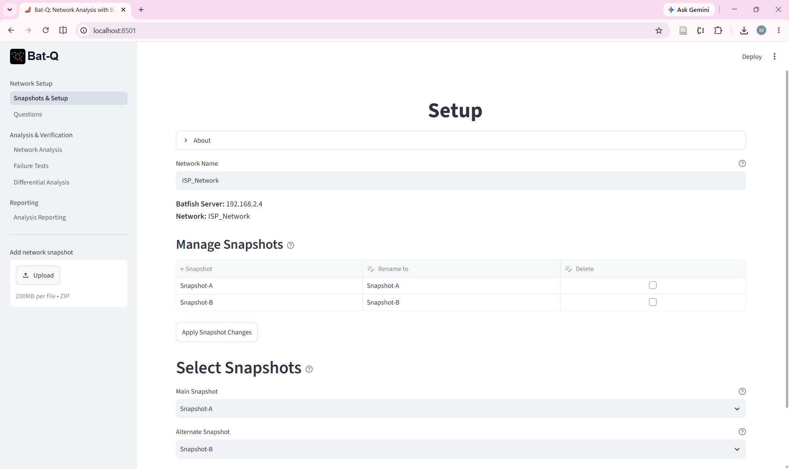
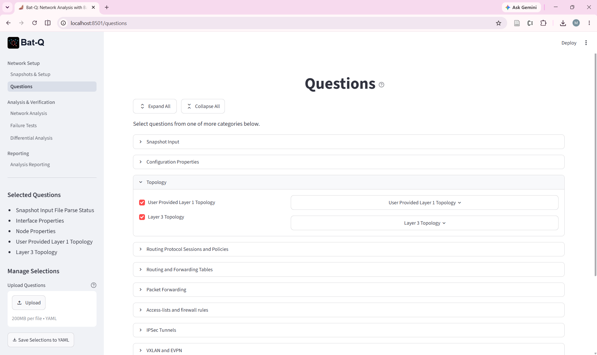
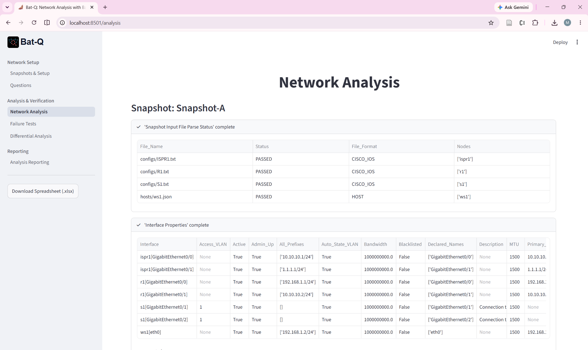
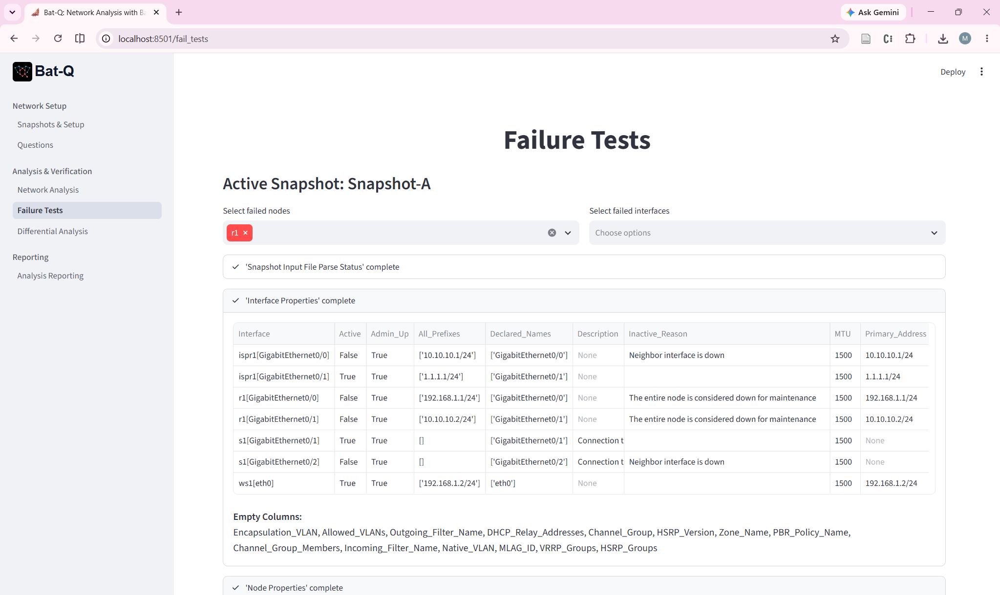
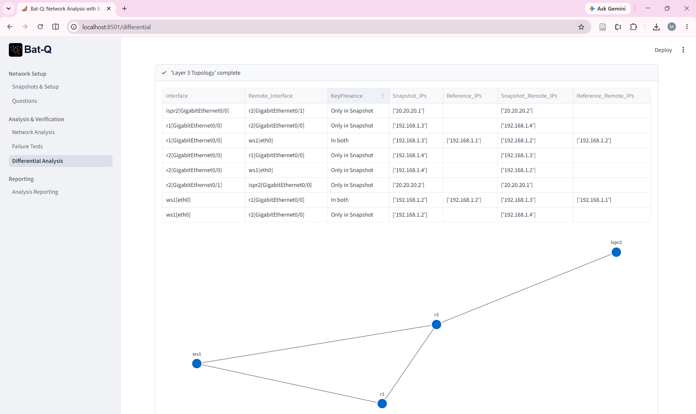

# Getting Started

## Packaging network configuration

Batfish expects network configuration files to be organized in a specific folder structure. The configuration files represent a single snaphost of the network. The folder structures is as follows:

```
snapshot [top-level folder of the name you chose]
    configs [folder with configurations files of network devices]
        router1.cfg
        router2.cfg
        …

    batfish [supplemental information (not device configurations)]
        isp_config.json
        …
```

Bat-Q requires that this folder structure is uploaded as a `.zip` file.

## Home page

At the Home page, you can upload the your network configuration files as `.zip` file. You can upload multiple configuration files. Batfish treats these files as network snapshots. The snapshots can be of the same network at different states or of different networks. Make sure you select one snapshot to be the active snapshot. You may also select another snapshot for comparisons.

Bat-Q names a snapshot after its `.zip` file. Batfish only accepts letters, digits, `-` and `_` in names, so any other characters are replaced by `_` (for example, `my network (1).zip` becomes the snapshot `my_network_1`), and a number is added if the name is already taken. Bat-Q never overwrites an existing snapshot when you upload.

The **Network Name** field selects the Batfish network, a workspace that groups related snapshots. Enter a new name to create a network. Network names follow the same rule as snapshot names.

Under **Manage Snapshots**, edit the *Rename to* column or tick *Delete* and click **Apply Snapshot Changes** to rename or delete snapshots. A snapshot cannot be renamed to a name that is already in use.

[](pics/batq-setup.png)

## Questions page

The Questions page displays (almost) all of the Batfish questions grouped in categories. Select the questions you would like to use from the left side of the main screen. The right side of the main screen shows input fields for the selected questions. Most questions accept optional input parameters so there is no need to specify these parameters. Mandatory parameters are denoted by an asterisk.

Use the side bar to save the selected questions (in the Downloads folder, by default). You can also upload previously saved questions from YAML file.

[](pics/batq-questions.png)

## Analysis page

The Analysis pages shows the answers to the selected questions. Most answers are shown in table format. Bat-Q tries to remove all empty table columns. These removed columns are listed below the table. Topology questions include also a simple diagram of the topology.

[](pics/batq-analysis.png)

## Assertions page

An assertion is a statement about the network that must be true, such as "there are no forwarding loops" or "web traffic from the border router reaches the server". On the Assertions page you build a list of assertions, run them on the active snapshot, and see which passed, which failed, and which could not be evaluated (an error is never counted as a pass). The list can be saved to and loaded from a YAML file in the side bar.

The [Assertions guide](assertions.md) describes every available assertion, the YAML format and the report.

## Failure Tests page

Batfish allows you to test various network failure scenarios by disabling any number of nodes and/or interfaces in the network. The failed components are included in forked snapshot that Bat-Q assigns a name in "<snapshot>_Fail" format.

Once the failed components are selected, answers to the selected questions will reflect the new state of the network. You can move back-and-forth between the Analysis page and the Failure Tests pages, or even add/delete/modify questions using the Questions pages, as many times as you wish.

[](pics/batq-failure.png)

## Differential page

You can compare two snapshots by selecting them from the Home page. The Differential page shows the answers to the same selected questions but in a slightly different format where the results are shown to belong to the first (Reference) snapshot, the second, or both.

Note that most Batfish questions can be used for single or two snapshots. There are only two questions that can be used for comparisons only.

[](pics/batq-differential.png)

## Reporting pages

Bat-Q produces two kinds of reports. They are separate because they serve different purposes.

- **Analysis Reporting** collects the answers shown on the Analysis page into one HTML report. The Analysis page also offers the same answers as an Excel spreadsheet (one sheet per answer).
- **Assertion Reporting** summarizes the results of the assertions: an overall verdict (failed, inconclusive or passed), a table with one line per assertion, and details for every assertion that failed or could not be evaluated. It is offered as an HTML report and as an Excel spreadsheet.

Run the questions or assertions first; the reporting pages use their latest results for the active snapshot.

## Limitations

Bat-Q is not a substitute for pyBatfish, which you will still need to use to get the full power of Batfish. Bat-Q is useful for quick configuration analysis or when writing custom Python code for the network analysis is inefficient or infeasible.
